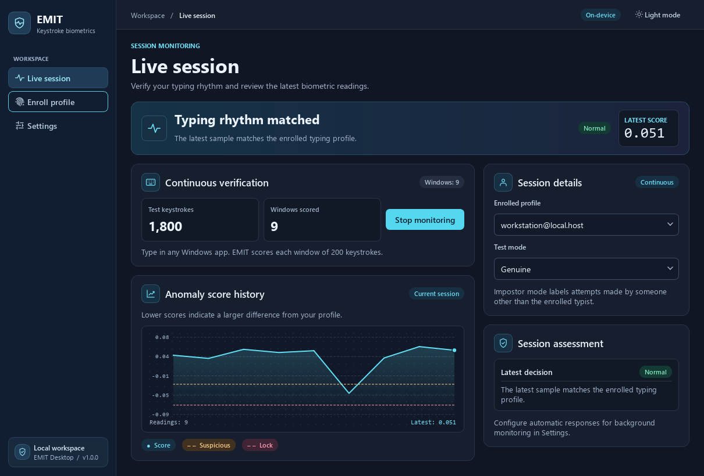
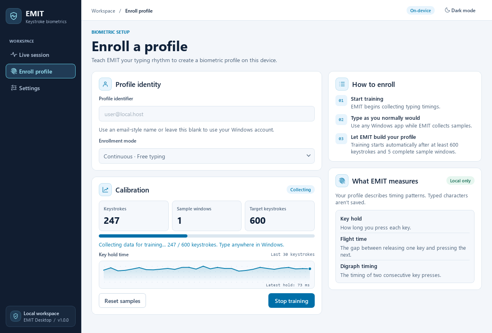
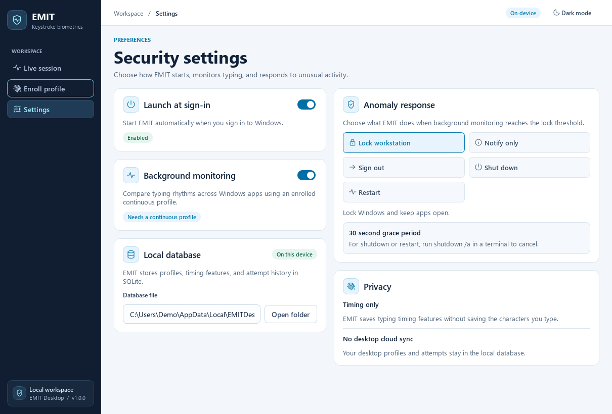
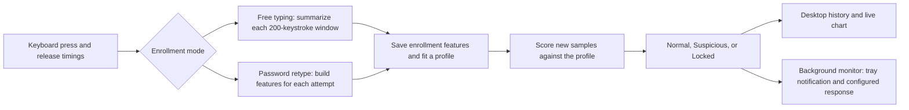

# EMIT — Continuous Authentication with Keystroke Dynamics

EMIT is a Windows desktop app that learns how you type and scores new typing samples against your enrolled profile. It can verify typing in the background while you work or run a fixed-password retype test inside the app. Desktop profiles, timing features, settings, and verification history stay in a local SQLite database.



<details>
<summary>Enrollment and settings screenshots</summary>

**Enrollment** shows how many keystrokes and complete sample windows have been collected, alongside a short chart of recent key hold times.



**Settings** controls launch at sign-in, background monitoring, and the action taken when the background session reaches the lock threshold.



</details>

The screenshots use demonstration profiles and data.

## Run on Windows

From the repository root, use PowerShell with Python 3.12 and the Windows Python launcher installed.

```powershell
py -3.12 -m venv .venv
.\.venv\Scripts\python.exe -m pip install -r requirements-desktop.txt
.\.venv\Scripts\python.exe emit_desktop.py
```

### Build the executable

```powershell
.\build.ps1
```

Open `dist\EMITDesktop\EMITDesktop.exe`. Keep the bundled `_internal` folder next to the executable when moving the app. EMIT opens a single instance per Windows user, so quit any running copy from the system tray before launching a different build.

To install the standard build for your Windows account, run `.\install.ps1`. It copies the bundle to `%LOCALAPPDATA%\Programs\EMITDesktop`, creates a Start menu shortcut, and registers EMIT to launch at sign-in. You can change launch behavior under **Settings**.

## How authentication works



### 1. Enroll a profile

| Mode | What to do | What EMIT measures |
| --- | --- | --- |
| **Continuous · Free typing** | Select the mode, press **Start training**, and type as usual in Windows apps. Enrollment completes after at least **600 keystrokes** and **5 complete sample windows**. | Windows Raw Input timestamps key presses and releases. Enrollment uses **200-keystroke windows** that advance by **100 keystrokes**. An idle gap over **2 seconds** clears a partial window. |
| **Password retype** | Use a made-up password of **6–12 characters**. Retype it **5–15 times**, pressing Enter after each attempt, then select **Train profile**. Backspace, Delete, or paste invalidates the sample. | The app records the timing pattern by key position and checks that each valid attempt has the enrolled length. |

Enter an email-style local identifier, or leave it blank to use a default derived from your Windows account. Choose a different identifier to create a second profile.

### 2. Extract features and train the model

- **Hold time** measures the interval from pressing a key to releasing it. **Down-to-down time** measures the gap between consecutive presses, and **up-to-down time** measures the gap from one release to the next press.
- Free typing produces **30 features** per window. These combine summary statistics for the three timing series with measures of key overlap, typing speed, pauses, bursts, duration, and speed variation.
- Password retype keeps the timing values by key position and adds **trigraph timing**, the elapsed time from a key press to the press two positions later.
- EMIT standardizes the feature values and fits a **One-Class Support Vector Machine (SVM)** using samples from the enrolled typist. Each profile gets its own suspicious and lock thresholds, estimated from held-out model scores across enrollment folds. EMIT saves the feature rows and rebuilds the model when the profile is loaded.

### 3. Verify typing and respond

1. In **Live session**, choose an enrolled profile. For password retype, enter the practice password. For a manual continuous test, select **Start monitoring** and type in Windows apps. Pick **Impostor** to label a test performed by a different typist.
2. Background monitoring scores non-overlapping windows of **200 keystrokes** for an enrolled continuous profile. Enable **Background monitoring** in Settings to use it. Continuous scoring smooths recent readings with an exponentially weighted moving average, giving the newest score a weight of **0.4**.
3. A lower score indicates that the sample differs more from the enrolled pattern. A score at or above the suspicious threshold is **Normal**. A score below that threshold but at or above the lock threshold is **Suspicious**. A score below the lock threshold, or three consecutive suspicious decisions, marks the session **Locked**.
4. The desktop app stores decisions in SQLite. The background monitor reports decisions through the system tray. At the lock threshold it stops monitoring and applies the selected response. Choices include **Lock workstation**, **Notify only**, **Sign out**, **Shut down**, and **Restart**. Shutdown and restart have a **30-second** cancellation window. Run `shutdown /a` to cancel.

The score measures similarity to the enrolled typing pattern and is uncalibrated as a probability of identity. Use **Notify only** while evaluating your profile and its false alarms.

## Data and privacy

| Component | What it handles |
| --- | --- |
| **Windows desktop** | Capture pairs key presses and releases in memory. SQLite stores profile identifiers, extracted timing features, settings, and decision metadata. Typed characters are never saved to the database. |
| **Local storage** | The normal Windows database path is `%LOCALAPPDATA%\EMITDesktop\emit.db`. Find the exact location under **Settings → Local database**. Treat a copy of this database as biometric data. |
| **Optional web prototype** | A JavaScript input component sends key press and release timings to Streamlit. The server stores enrolled feature rows in Turso. The current web UI keeps the live score chart in Streamlit session state. Use a practice password and demo data with this version. |

## Technology and repository map

| Area | Technology | Where |
| --- | --- | --- |
| Desktop UI | Python, PySide6 / Qt | [desktop/ui](desktop/ui), [emit_desktop.py](emit_desktop.py) |
| Windows input | Raw Input API via Python `ctypes` | [desktop/capture.py](desktop/capture.py), [desktop/windowizer.py](desktop/windowizer.py) |
| Features and model | NumPy, pandas, scikit-learn | [features.py](features.py), [model.py](model.py) |
| Enrollment and decisions | One-Class SVM thresholds and continuous score smoothing | [desktop/auth.py](desktop/auth.py), [desktop/continuous.py](desktop/continuous.py), [desktop/monitor.py](desktop/monitor.py) |
| Local storage and Windows actions | SQLite, Windows APIs, and registry-based startup | [desktop/storage.py](desktop/storage.py), [desktop/response.py](desktop/response.py), [desktop/autostart.py](desktop/autostart.py) |
| Packaging and tests | PyInstaller, PowerShell, pytest | [emit_desktop.spec](emit_desktop.spec), [build.ps1](build.ps1), [tests](tests) |
| Research and web prototype | Streamlit, JavaScript, Turso/libSQL, Matplotlib, joblib | [app.py](app.py), [components/keystroke](components/keystroke), [db.py](db.py), [train.py](train.py), [evaluate.py](evaluate.py) |

## Tests and evaluation

```powershell
.\.venv\Scripts\python.exe -m pytest tests
.\.venv\Scripts\python.exe desktop/analyze_live.py
```

The desktop analysis command summarizes locally recorded genuine and impostor attempts. It reports genuine flag rates, impostor detection, false locks, and how many attempts it took to reach a lock.

The offline experiment uses the CMU fixed-password benchmark. It fits a separate profile per subject using sessions 1–4, tests genuine scores on sessions 5–8, and takes five impostor samples per other subject. The evaluator compares hold-only, hold plus digraph, and hold plus digraph and trigraph features. It reports mean ROC AUC and equal error rate (EER) across the first 20 subjects by default and writes [roc.png](roc.png). These results describe the fixed-password experiment. Evaluate free typing separately with live tests.

```powershell
.\.venv\Scripts\python.exe train.py tri
.\.venv\Scripts\python.exe evaluate.py
```

## Optional Streamlit prototype

Install the web dependencies, copy the example secrets file, and fill in `TURSO_DATABASE_URL` and `TURSO_AUTH_TOKEN` for your Turso database.

```powershell
.\.venv\Scripts\python.exe -m pip install -r requirements.txt
Copy-Item .streamlit/secrets.toml.example .streamlit/secrets.toml
.\.venv\Scripts\python.exe -m streamlit run app.py
```

The prototype supports password retype. For hosted Streamlit, set the same values in the host's secrets configuration and use `app.py` as the entry point. See [AZURE.txt](AZURE.txt) for the existing Azure deployment instructions.

## Credits

- The desktop version extends the original EMIT keystroke dynamics research project. [Upstream project](https://github.com/atiqul96/EMIT_Project)
- The benchmark data and protocol come from Kevin S. Killourhy and Roy A. Maxion, *Comparing Anomaly-Detection Algorithms for Keystroke Dynamics* (DSN 2009). [CMU benchmark and paper](https://www.cs.cmu.edu/~keystroke/)
